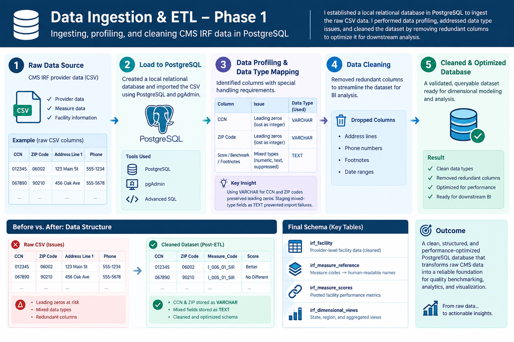
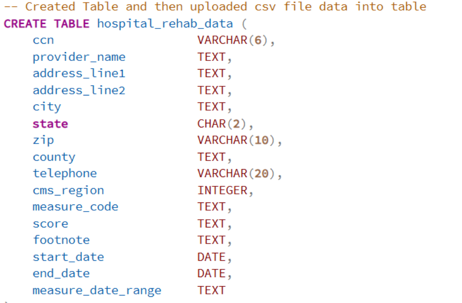
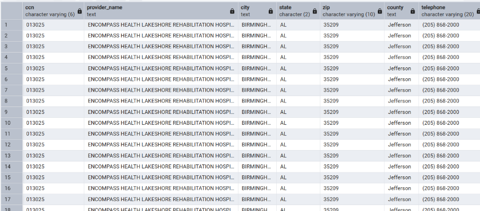
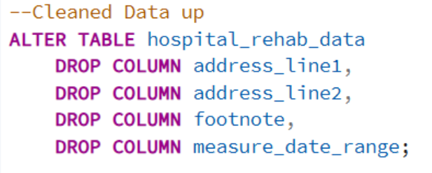

# Hospital Rehab Analysis 

## Inpatient Rehabilitation Facility Quality Benchmarking: A CMS Care Compare Analysis

Business Context: Healthcare IT companies, payers, and provider networks require clear visibility into rehabilitation facility performance to support network adequacy decisions, value-based care contracting, referral routing, and competitive positioning. While CMS publishes this data, it is raw and measure-by-measure, making it difficult to translate into actionable provider-level intelligence.
Problem Statement: The CMS Inpatient Rehabilitation Facility (IRF) data is structured in a long format with inconsistent scoring types (numeric rates, confidence intervals, and categorical benchmarks). This project builds a reproducible ETL pipeline to transform raw CMS data into a provider-level quality scorecard and benchmarking dashboard.

[Full Document -Google Doc of my process and the steps](https://docs.google.com/document/d/e/2PACX-1vS3tJaHbVXGVpVSfEMNxhvGRQtVBWjJ2rbVhBLlxZ2YE4vpk9Qsa7RNttc7ToIJeCAczNXYh2Z_Pihh/pub)

Data Sources:
[IRF Table Dictionary](https://data.cms.gov/provider-data/sites/default/files/data_dictionaries/inpatient/IRF_Data_Dictionary.pdf)

[Inpatient Rehabilitation Facility - Provider Data
](https://data.cms.gov/provider-data/dataset/v9e4-nwhh)

## Project Summary: Tools & Skills Matrix
Tools Utilized:
- Database & ETL: PostgreSQL, pgAdmin, Advanced SQL, Git Github, Microsoft VS code
- Data Validation: Microsoft Excel (upcoming :Pivot Tables, Data Modeling)
- Business Intelligence: Power BI (Upcoming: DAX, Interactive Dashboards)
- Programming & Automation: Python (Upcoming: Pandas, Scikit-Learn)

Core Skills Demonstrated:
- Data Engineering: ETL Processes, Database Design, DDL/DML, Data Profiling, Data Ingestion, Data Cleaning, Data Type Mapping
- Data Analytics & Modeling: Dimensional Modeling, Relational Mapping, Data Dictionary Creation, Advanced SQL (Window Functions, CTEs, Views), Pivoting, Statistical Analysis, Correlation Analysis, Composite Scoring
- Business Intelligence & Reporting: Benchmarking, Data Aggregation, Geographic Pattern Analysis, Data Quality Assessment, Data Suppression Techniques, Sensitivity Analysis, Visualizations, Stakeholder Reporting

## 📂 SQL Pipeline & Code Structure

Links below to view the modular SQL scripts that power this analysis:

*   **[01_create_table.sql](/01_create_tables.sql):** Initializes the raw staging table for the CMS CSV data and creates the semantic `measure_reference` dictionary to decode clinical quality metrics.
*   **[02_cleaning_tables.sql](/02_cleaning.sql):** Executes data cleaning by dropping non-analytical columns (address, phone, footnotes) to optimize database performance.
*   **[03_scorecards_and_views.sql](/03_scorecards_and_views.sql):** Answers Core Questions 1-4 by pivoting the long-format data into a provider-level scorecard, building geographic roll-up views, testing measure-specificity (co-performance), and analyzing data suppression bias.
*   **[04_composite_index.sql](/04_composite_index.sql):** Answers Core Question 5 by engineering a weighted composite quality indicator, ranking the top/bottom performers, and calculating the final benchmark coverage statement.

## Phase 1: Data Ingestion & ETL (Extract, Transform, Load)

I established a local relational database in PostgreSQL to ingest the raw CSV data. During the data ingestion phase, I performed a data profiling assessment, identifying that columns like CCN and ZIP codes contained leading zeros that required VARCHAR data types rather than integers. Furthermore, mixed-type fields (numeric scores, text benchmarks, and suppressed footnotes) were staged as TEXT to prevent import failures. Finally, I executed data cleaning by dropping redundant columns (address lines, phone numbers, footnotes, and date ranges) to optimize the dataset for downstream business intelligence analysis.

## Phase 2: Dimensional Modeling & Measure Reference
- Skills Demonstrated: Data Modeling, Relational Mapping, Data Dictionary Creation
To make the cryptic CMS measure codes readable for stakeholders, I engineered a measure_reference table to serve as a data dictionary. By mapping codes (e.g., I_006_01_SIR) to human-readable measure families (Pressure Ulcer, Falls, Readmissions) and defining the "direction of good" (higher vs. lower is better), I created a semantic layer. This step was critical for ensuring that the downstream data visualization and composite scoring accurately reflected clinical realities.

## Phase 3: Core Analysis & Answering the Business Questions
1. Which IRFs perform best and worst on key quality measures?
I built the irf_facility_scorecard table, pivoting the long-format data so each row represents a unique facility (CCN) with side-by-side performance metrics. By leveraging the benchmark labels (Better, No Different, Worse) as the primary statistical signal rather than just raw numeric scores, I isolated statistical significance. This allowed me to generate precise top 10 and bottom 10 lists for Pressure Ulcers and Falls, proving that a minority of facilities significantly outperform the national baseline.

2. How does facility quality vary by state and CMS region, and are there geographic patterns?
I created aggregated views (irf_state_quality and irf_region_quality) to analyze geographic patterns. By calculating the percentage of facilities outperforming the benchmark per state, I identified regional clusters. The analysis revealed that while no region is uniformly excellent, specific states demonstrate higher concentrations of below-benchmark performance on readmissions (e.g., WV, NV, FL). I also applied data suppression techniques (filtering out states with fewer than 5 facilities) to ensure statistical validity.

3. Do facilities that perform well on one measure also perform well on others?
To test the hypothesis of whether quality is general or measure-specific, I built a co-performance matrix and utilized CORR() functions. The results demonstrated that quality is highly measure-specific. Facilities that excel in discharge-to-community do not necessarily excel in readmissions. This correlation analysis proved that a single "quality score" cannot substitute for granular, measure-level evaluation in referral decisions.

4. Which facilities have missing or suppressed data, and how does it affect benchmarking?
I analyzed data quality by quantifying Not Available scores and footnotes. The analysis revealed that suppression is systematically concentrated in low-volume and specialty facilities. By comparing average eligible case volumes between reporting and suppressed groups, I proved that missing data biases national and state averages toward larger, established facilities. This data quality assessment highlighted the critical need to explicitly state reporting denominators in all visualizations to avoid misleading stakeholders.

5. Can we build a composite quality indicator to support referral or network decisions?
I engineered a transparent composite index (irf_composite_index), converting benchmark categories into a +1 / 0 / -1 scale. A sensitivity analysis revealed that rankings shift significantly under different weighting schemes, and the final coverage statement showed that only 21.3% (260 out of 1,222) of facilities are fully benchmarkable across all four measures. Therefore, the composite index serves only as a screening tool for shortlisting, while final network decisions must rely on the measure-level scorecard.

## Final Conclusion & Next Steps
This PostgreSQL phase successfully transformed raw, messy CMS data into a validated, queryable asset. By combining advanced SQL techniques with clinical domain knowledge, I demonstrated that while CMS data is highly actionable for measure-specific benchmarking, it cannot support a single composite ranking due to measure-specificity and systematic data suppression.
Future Phases: I will export these structured views into Microsoft Excel for pivot table validation and Power BI to build an interactive, stakeholder-facing dashboard (incorporating DAX and dynamic filtering). Finally, I will utilize Python (Pandas/Scikit-Learn) to automate the ETL pipeline and perform predictive modeling on facility performance trends.

**Down Below i have included the steps i took to create through answering the core questions and how i navigated through engineering this project along with visuals and table results from the queries:**

Following the successful ingestion of the dataset, I validated the data integrity using SELECT * queries to confirm the row counts and schema alignment. I then executed a data optimization phase, dropping non-analytical columns—including address lines, phone numbers, footnotes, and date ranges—that were extraneous to the core business problem. This schema refinement minimized table bloat, reduced query execution times, and focused the dataset exclusively on the geographic, provider, and quality metrics required to deliver actionable intelligence on facility benchmarking.

With the schema refined and data integrity validated, I transitioned into the analytical phase by defining a set of core business questions to drive the project's value proposition:

Which Inpatient Rehabilitation Facilities (IRFs) perform best and worst on key quality measures (e.g., pressure ulcers, falls with major injury, functional outcomes, readmissions)?

How does facility quality vary by state and CMS region, and are there discernible geographic patterns?

Do facilities that perform well on one measure also perform well on others, or is quality highly measure-specific?

Which facilities have missing or suppressed data, and how does this data quality issue impact our ability to benchmark accurately?

Can we construct a composite quality indicator to support referral or network decisions?

Addressing Question 1: Identifying Top and Bottom Performers

My analytical approach for this question was to isolate statistically significant performance rather than relying on raw, potentially misleading scores. I designed a series of structured queries utilizing CASE statements and MAX aggregations to pivot the long-format data into a provider-level scorecard. I then applied WHERE clause filters and ORDER BY sorting to extract the top 10 and bottom 10 facilities based on benchmark classifications (Better, No Different, Worse). This methodology ensured that the resulting lists reflected facilities that were statistically distinct from the national baseline, providing a clear, actionable view of the market's best and worst performers.
